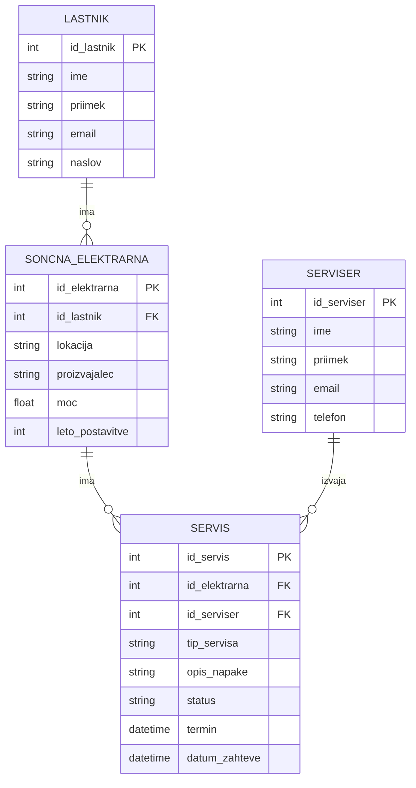

# Podatkovni model rešitve

## Vsaj 3 povezane entitete in njihova glavna polja
1. LASTNIK
- *id_lastnik*
- *ime*
- *priimek*
- *email*
- *naslov*

2. SONCNA_ELEKTRARNA
- *id_elektrarna*
- *id_lastnik*
- *lokacija*
- *proizvajalec*
- *moc*
- *leto_postavitve*

3. SERVIS
- *id_servis*
- *id_elektrarna*
- *id_serviser*
- *tip_servisa*
- *opis_napake*
- *status*
- *termin*
- *datum_zahteve

4. SERVISER
- *id_serviser*
- *ime*
- *priimek*
- *email*
- *telefon*

## Povezave med entitetami

- LASTNIK 1:N SONCNA_ELEKTRARNA

- SONCNA_ELEKTRARNA 1:N SERVIS

- SERVISER N:1 SERVIS

## Osnutek podatkovnega modela

# Dopolnitev: profili in seje

Migracija `005-account-usernames` doda `account_usernames`: globalno enolično
uporabniško ime in povezavo na točno enega lastnika, serviserja ali vodjo.
Prijava `/api/auth/login` sprejme e-pošto ali dodeljeno uporabniško ime in iz
shranjenega računa ugotovi vlogo. Izbira vloge je samo na registraciji.
Obstoječi računi lahko še vedno uporabljajo e-pošto; migracija ne spreminja njihovih gesel.

Migracija `004-owner-plants` razširi `solar_plants` z neobveznima poljema
`manufacturer VARCHAR(100)` in `installation_year SMALLINT` (1–9999).
Obstoječi `installed_on` ostaja datum namestitve; leto se mora z njim ujemati,
kadar sta oba znana. Pri starejših zapisih se leto izpelje iz znanega datuma.
API dovoljuje tudi samo leto, brez izmišljenega datuma. Podatki o moči, panelih,
bateriji in lokaciji ostajajo v obstoječih stolpcih. Pravila in pogodba API so v
[`specs/003-owner-plants/spec.md`](specs/003-owner-plants/spec.md).

Migracija `002-user-profiles-and-sessions` v `database/schema.sql` doda:

- `customers.profile_image_data` in `employees.profile_image_data`: neobvezna
  raster profilna slika kot podatkovni URL; API omeji format in velikost na 256 KB.
- `account_sessions`: SHA-256 hash naključnega žetona, datum izteka in referenca na
  točno enega lastnika ali zaposlenega. Ne hrani izvornega žetona ali gesel.

Prikaz hiše uporablja obstoječa polja `solar_plants.panel_count`,
`installed_capacity_kw` in naslov. Slika je shematska; ni podatkov o geometriji strehe.
Zgodovina v profilu uporablja samo zaključene servise lastnikovih elektrarn,
brez internih servisnih zapisnikov.

