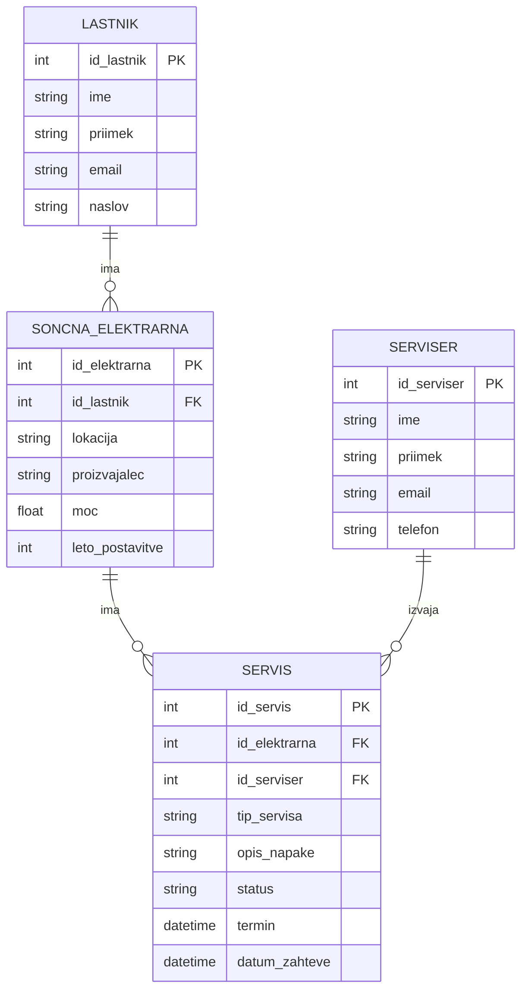

# Podatkovni model rešitve

## Vsaj 3 povezane entitete in njihova glavna polja
1. LASTNIK
- *id_lastnik*
- *ime*
- *priimek*
- *email*
- *naslov*

2. SONCNA_ELEKTRARNA
- *id_elektrarna*
- *id_lastnik*
- *lokacija*
- *proizvajalec*
- *moc*
- *leto_postavitve*

3. SERVIS
- *id_servis*
- *id_elektrarna*
- *id_serviser*
- *tip_servisa*
- *opis_napake*
- *status*
- *termin*
- *datum_zahteve

4. SERVISER
- *id_serviser*
- *ime*
- *priimek*
- *email*
- *telefon*

## Povezave med entitetami

- LASTNIK 1:N SONCNA_ELEKTRARNA

- SONCNA_ELEKTRARNA 1:N SERVIS

- SERVISER N:1 SERVIS

## Osnutek podatkovnega modela

