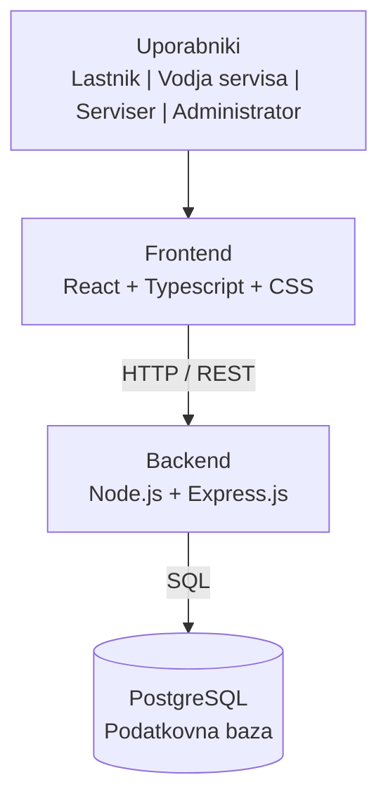

# Arhitektura in tehnološki sklad

## Arhitektura
Aplikacija bo zasnovana kot spletna aplikacija, sestavljena iz treh glavnih delov:

- **Frontend** – uporabniški vmesnik, izdelan s tehnologijami React, Typescript in CSS. Uporabniku omogoča prijavo, pregled podatkov ter izvajanje funkcionalnosti glede na njegovo vlogo.
- **Backend** – strežniški del aplikacije, izdelan s Node.js in Express.js. Skrbi za obdelavo zahtev, poslovno logiko, preverjanje podatkov, avtentikacijo in upravljanje pravic uporabnikov.
- **Podatkovna baza** – relacijska podatkovna baza PostgreSQL, v kateri se hranijo podatki o lastnikih, sončnih elektrarnah, serviserjih in servisih.

Frontend in backend komunicirata prek **HTTP/REST API**, backend pa s podatkovno bazo komunicira prek **SQL**.

### Diagram arhitekture

### Podatkovna baza
Za podatkovno bazo bo uporabljen **PostgreSQL**, saj je rešitev zasnovana na relacijskem podatkovnem modelu. Glavne entitete so:

- **Lastnik**
- **Sončna elektrarna**
- **Servis**
- **Serviser**

Med njimi so vzpostavljene povezave s primarnimi in tujimi ključi.

### Avtentikacija in upravljanje uporabnikov
Uporabnik se v aplikacijo prijavi s svojim uporabniškim računom. Po uspešni prijavi sistem preveri njegovo vlogo in mu omogoči dostop do funkcionalnosti, ki so namenjene njegovi vlogi.

Predvidene vloge so:

* **Lastnik** – prijava napak in zahtev za pregled.
* **Vodja servisa** – dodeljevanje servisov in določanje terminov.
* **Serviser** – pregled dodeljenih servisov in izdelava servisnih poročil.
* **Administrator** – upravljanje uporabnikov in njihovih pravic.

### Lokalni zagon
Aplikacija bo v času razvoja in testiranja delovala lokalno na računalniku. Frontend in backend se zaženeta lokalno, prav tako lokalno deluje PostgreSQL podatkovna baza.

Uporabnik do aplikacije dostopa prek spletnega brskalnika z lokalnim naslovom *localhost*.

## Tehnološki sklad
- Frontend: React, Typescript, CSS
- Backend: Node.js in Express.js
- Podatkovna baza: PostgreSQL
- Avtentikacija: prijava uporabnikov, seje in uporabniške vloge
- Lokalni razvoj: VS Code, PostgreSQL, Node.js, Express.js
- Komunikacija: HTTP / REST API

## Arhitekturne odločitve

### Ločitev frontenda, backenda in podatkovne baze
Sistem je razdeljen na frontend, backend in podatkovno bazo. Takšna razdelitev omogoča lažje vzdrževanje in kasnejše spreminjanje posameznih delov sistema.

### Spletna aplikacija
Izbrana je spletna aplikacija, saj lahko uporabniki do sistema dostopajo prek spletnega brskalnika brez nameščanja programa na računalnik.

### Node.js in Express.js
Za backend sta izbrana Node.js in Exxpress.js. Zagotavljata osnovna orodja za izdelavo spletnega strežnika in API-ja. Izbira je primerna za manjšo spletno aplikacijo, saj omogoča postopno dodajanje funkcionalnosti brez nepotrebne kompleksnosti.

### PostgreSQL
Izbran je PostgreSQL, ker je podatkovni model relacijski in vsebuje več med seboj povezanih entitet. MySQL omogoča uporabo tabel, primarnih in tujih ključev ter SQL poizvedb.

### Upravljanje uporabniških vlog
Uporabniki imajo različne vloge in s tem različne pravice. Na ta način lahko sistem zagotovi, da posamezen uporabnik dostopa samo do funkcionalnosti, ki jih potrebuje.
